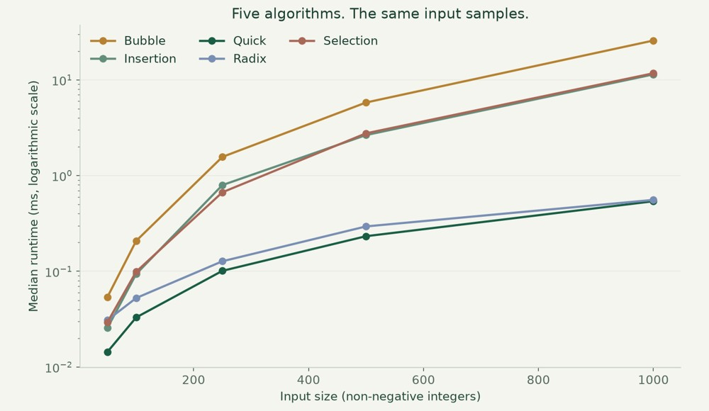

# Sorting algorithms, measured

Implement five sorting algorithms and compare them using verified, repeatable measurements.



**Python · Algorithms · Benchmarking · Matplotlib**

[Visual case study](https://benjanning.github.io/projects/projects/sorting-algorithms/) · [Main portfolio](https://benjanning.github.io/projects/)

## What it does

Implemented bubble, insertion, selection, quick and radix sorting, with visual explanations and benchmarking.

## Key features

- Bubble, insertion, selection, quick and radix sorting.
- Identical seeded input samples for each algorithm.
- Five repetitions per input size; median runtime measured with perf_counter.
- Every measured output checked against Python’s sorted result.

## Run the verified benchmark

```bash
python -m unittest test_algorithms.py
python benchmark_verified.py
```
The standard-library benchmark writes verified_timings.csv. No plotting dependency is required to run it.

## Technical details and verification

Four regression test methods pass. The benchmark checks 125 sorts across sizes 50–1,000. The chart represents verified_timings.csv, distinct from historical timing exports. Timings depend on interpreter, hardware and load; random non-negative integer inputs do not cover every workload. Radix sort rejects negative/non-integer inputs, and recursive quicksort has adverse-input recursion limits.

[Original documentation and academic references](COURSEWORK.md) · [Visual provenance](assets/PROVENANCE.md)
