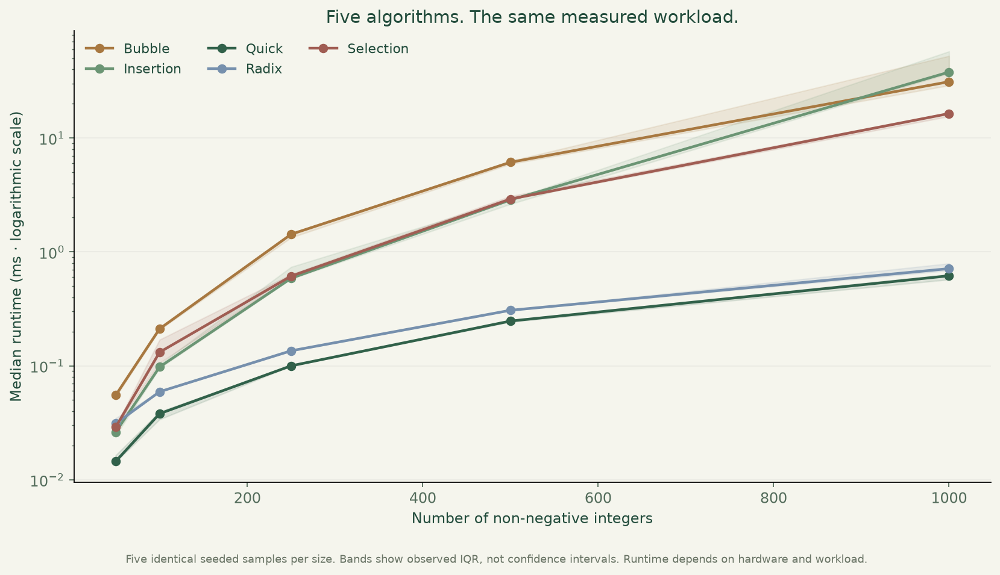
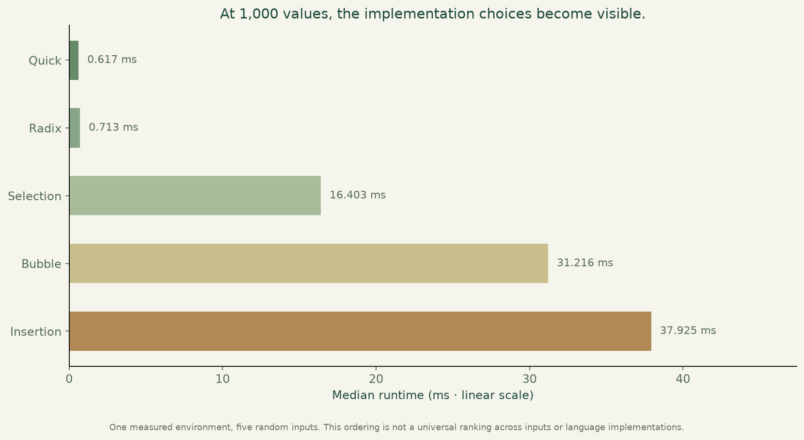

# Sorting algorithms, measured and explained

Five original Python implementations, traceable measurements and a small explorer showing the work behind the order.



**Python · Algorithms · Benchmarking · JavaScript · Matplotlib**

[Visual case study](https://benjanning.github.io/projects/projects/sorting-algorithms/) · [Portfolio](https://benjanning.github.io/projects/)

## Measure fairly. Explain clearly.

Bubble, insertion, selection, quick and radix sort receive the same five seeded samples at each size from 50 to 1,000. Every measured result is checked against Python's sorted output. Input copies and correctness checks stay outside timing. Raw measurements, medians and observed interquartile ranges are saved with the environment and exact algorithm hashes.



This is one workload in one environment, not a universal speed ranking. Bands show observed IQR, not confidence intervals. The original V1 `verified_timings.csv` and historical charts remain intact; new results live under `results/`.

## Step through actual operations

The static explorer in `docs/` implements instrumented JavaScript ports of bubble sort, selection sort and rightmost-pivot quicksort. Change the starting pattern, move forwards/backwards, play/pause or reset to the same input. The trace shows real comparisons and swaps; it does not animate an already-sorted answer. The Python project still includes all five algorithms.

Browser-port tests compare final outputs with actual Python results, check that every intermediate state preserves the multiset and verify independently known operation counts. Selection's self placements are visible but are not counted as index-changing swaps. Animation pace is never presented as a benchmark.

## Reproduce

```bash
python -m pip install -r requirements.txt
python benchmark_portfolio.py
python plot_portfolio.py
python -m unittest discover -p "test_*.py" -v
python scripts/build_fixtures.py
python scripts/build-demo.py
npm ci
npm run test:trace
npx playwright install chromium
npm run test:browser
```

Seven Python and three Node regression tests pass locally. Source CI also checks the browser controls, completion, reset and a dense mobile case before capturing genuine screenshots and publishing the explorer. Its successful exact-revision run is linked from the portfolio.

`benchmark_portfolio.py` reuses raw observations only if all algorithm hashes and saved data hashes match. `--refresh` deliberately records a new experiment. Text hashes normalize line endings so an unchanged Windows checkout is not mistaken for changed algorithm logic on Linux. See [raw timings](results/raw-timings.csv), [aggregates](results/timings.csv) and [methodology/environment](results/benchmark-methodology.json).

## Scope

Radix sort accepts non-negative integers and rejects booleans/fractions. Recursive quicksort uses a rightmost pivot and has worst-case recursion limits on adverse inputs. The browser explorer is limited to 24 non-negative values and three approaches. Neither its counts nor animation pace stand in for timing the Python implementations.

The original coursework notebook, figures and explanations remain available. The source release workflow exports tested figures/screenshots and a computed result summary to the central portfolio's review-PR synchronisation.

[Original coursework and references](COURSEWORK.md) · [Visual provenance](assets/PROVENANCE.md)
