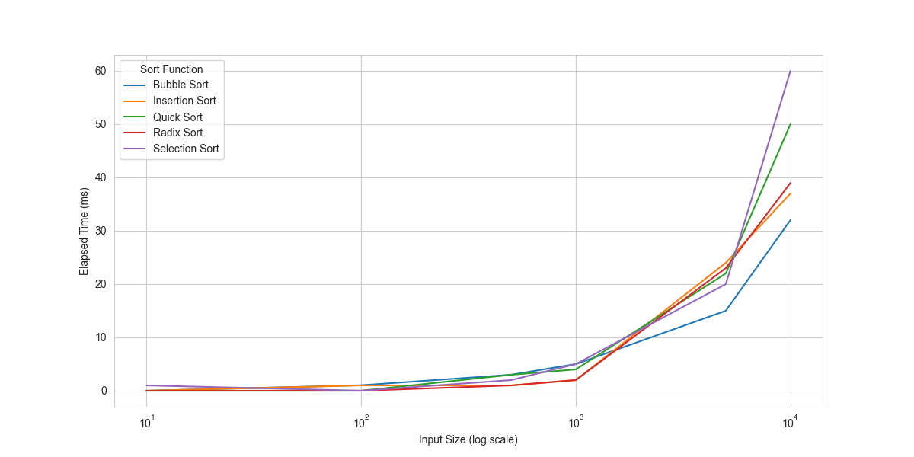

# Sorting Algorithms: Implementation & Benchmarking

**Python · Algorithms · Benchmarking · Jupyter Notebook**

An academic investigation of how different sorting strategies work and how their execution times compare as input sizes change.



## Project at a glance

- **Question:** How do different sorting algorithms behave, and what trade-offs do their approaches involve?
- **Approach:** Implement five algorithms, explain their steps and theoretical complexities, and compare measured execution times.
- **Algorithms:** Bubble sort, selection sort, insertion sort, quick sort and radix sort.
- **Outputs:** A detailed [Jupyter research notebook](./Sorting%20Algorithms%20Project%20-%20Computational%20Thinking%20with%20Algorithms.ipynb), [benchmark chart](./benchmark_plot.png), [average timings](./average_times.csv) and [elapsed timings](./elapsed_times.csv).

## Explore the code

| Topic | File |
| --- | --- |
| Bubble sort | [bubble_sort.py](./bubble_sort.py) |
| Selection sort | [selection_sort.py](./selection_sort.py) |
| Insertion sort | [insertion_sort.py](./insertion_sort.py) |
| Quick sort | [quick_sort.py](./quick_sort.py) |
| Radix sort | [radix_sort.py](./radix_sort.py) |
| Full written investigation | [Notebook](./Sorting%20Algorithms%20Project%20-%20Computational%20Thinking%20with%20Algorithms.ipynb) |

## Verified regression tests

A new [`test_algorithms.py`](./test_algorithms.py) exercises all five algorithms using empty, reversed, repeated and random inputs. The local regression suite passed after fixing two implementation issues.

```bash
python -m unittest -v test_algorithms.py
```

**Reproducibility note:** The benchmark chart and timing CSVs are historical coursework outputs and have not been regenerated following these corrections. Treat them as illustrative until the full benchmarks are rerun under a documented environment.

## Reviewing the work

Open the notebook on GitHub to read the explanations and stored figures without installing anything. To re-run code, use a Python/Jupyter environment and install the libraries imported by the notebook.

**Interpretation note:** Benchmarks measure particular implementations and inputs; they are not universal rankings. This is an educational comparison, not a production performance library.

---

Part of my Higher Diploma in Computing (Data Analytics). [View the full portfolio](https://github.com/benjanning/programming2022).
